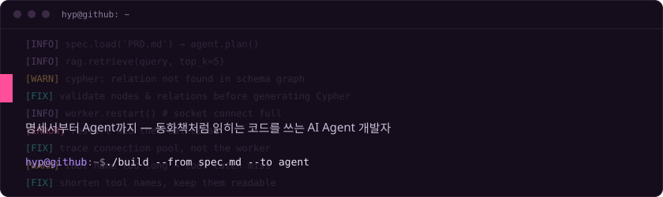

```text
$ whoami
박호영 · 디포커스 AI팀 · LangGraph · RAG · FastAPI로 기업용 AI Agent를 설계하고 만듭니다
$ cat principle.txt
옆집 할아버지 할머니도 협업할 수 있는 코드와 명확한 설계
```

<table>
<tr>
<td valign="top" width="398">

### ~/now

`[01]` 정유사 기준정보 정비 플랫폼<br>
`[02]` GraphRAG 기반 BI 에이전트

</td>
<td valign="top" width="398">

### ~/career

`2023.08` 고려대 세종 응용통계 졸업<br>
`2024.07` 디포커스 입사 · Data Biz 본부<br>
`HEAD →` AI팀 선임 · LLM / RAG / Agent

</td>
</tr>
</table>

## ~/git log --blog

<!-- BLOG-POST-LIST:START -->
`2026.11.16` [Claude 디자인, 한 줄 프롬프트의 진실: 쇼츠 속 화면과 내 화면이 다른 이유](https://hypark.tistory.com/39)<br>
`2026.11.16` [SQLite에서 PostgreSQL로 옮긴 날, 작업이 0%에서 멈췄다](https://hypark.tistory.com/38)<br>
`2026.11.04` [WSL2 Docker 서버 외부 접속 안 될 때: 0.0.0.0 바인딩&middot;방화벽을 다 열어도 안 되던 문제를 netsh portproxy로 해결](https://hypark.tistory.com/37)<br>
`2026.10.29` [WSL2 '가상화가 활성화되지 않은 이 컴퓨터에서는 WSL2를 시작할 수 없습니다' 오류: VMware VM 중첩 가상화로 해결](https://hypark.tistory.com/36)<br>
`2026.10.28` [그림으로 한 장씩 배우는 무료 개발 공부 사이트, 개발자 학습 노트](https://hypark.tistory.com/35)<br>
<!-- BLOG-POST-LIST:END -->

## ~/certs

`2025.12` Salesforce Certified Data Cloud Consultant<br>
`2024.12` 빅데이터분석기사<br>
`2024.03` 데이터분석 준전문가 (ADsP)<br>
`2023.10` SQL 개발자 (SQLD)
