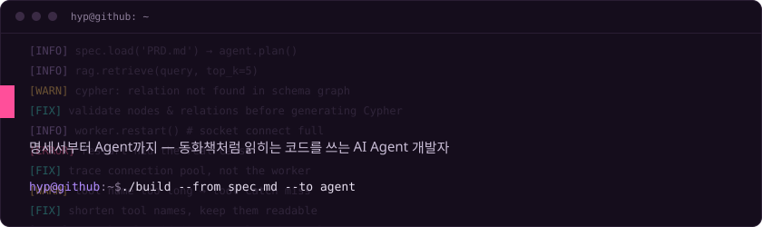

```text
$ whoami
박호영 · 디포커스 AI팀 · LangGraph · RAG · FastAPI로 기업용 AI Agent를 설계하고 만듭니다
$ cat principle.txt
옆집 할아버지 할머니도 협업할 수 있는 코드와 명확한 설계
```

<table>
<tr>
<td valign="top" width="398">

### ~/now

`[01]` 정유사 기준정보 정비 플랫폼<br>
`[02]` GraphRAG 기반 BI 에이전트

</td>
<td valign="top" width="398">

### ~/career

`2023.08` 고려대 세종 응용통계 졸업<br>
`2024.07` 디포커스 입사 · Data Biz 본부<br>
`HEAD →` AI팀 선임 · LLM / RAG / Agent

</td>
</tr>
</table>

## ~/git log --blog

<!-- BLOG-POST-LIST:START -->
`2026.10.28` [그림으로 한 장씩 배우는 무료 개발 공부 사이트, 개발자 학습 노트](https://hypark.tistory.com/35)<br>
`2026.06.01` [GraphRAG에서 존재하지 않는 노드와 관계로 Cypher를 생성하던 문제](https://hypark.tistory.com/30)<br>
`2026.05.29` [Socket Connect Full 에러가 Worker 재시작으로 가려졌던 문제](https://hypark.tistory.com/29)<br>
`2026.05.28` [Agent Tool Name이 길어졌을 때 발생한 Tool Catch Miss](https://hypark.tistory.com/28)<br>
`2026.05.27` [카지노 이상탐지 AI 개발기 1편: 정상/비정상 2진분류 모델로는 부족했던 이유](https://hypark.tistory.com/27)<br>
<!-- BLOG-POST-LIST:END -->

## ~/certs

`2025.12` Salesforce Certified Data Cloud Consultant<br>
`2024.12` 빅데이터분석기사<br>
`2024.03` 데이터분석 준전문가 (ADsP)<br>
`2023.10` SQL 개발자 (SQLD)
